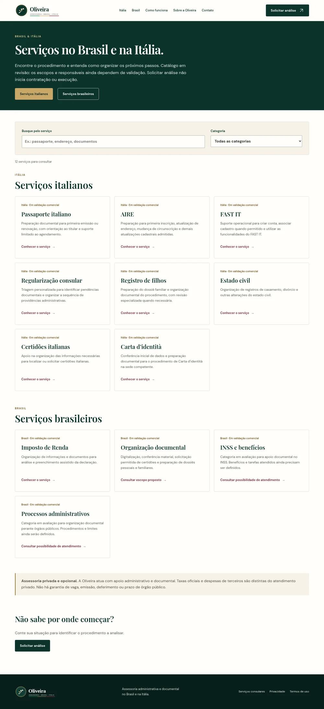
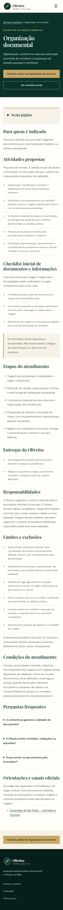

# Capturas finais desktop e mobile

Capturas reais do Preview `dpl_HHNqoPNd6pPYNDBqVTmc8e9aoVrG`, implementação `5d40796`. Chromium, fontes e imagens carregadas, movimento reduzido, viewport 390 × 900 e 1366 × 900. Imagens completas em WebP; desktop reduzido a 1000 px para facilitar leitura, mobile preserva 390 px. Sem dados reais ou envios de formulário.

| Página | Mobile | Desktop |
| --- | --- | --- |
| home | [Abrir](evidence/home-390.webp) | [Abrir](evidence/home-1366.webp) |
| catalogo | [Abrir](evidence/catalogo-390.webp) | [Abrir](evidence/catalogo-1366.webp) |
| ir | [Abrir](evidence/ir-390.webp) | [Abrir](evidence/ir-1366.webp) |
| passaporte-italiano | [Abrir](evidence/passaporte-italiano-390.webp) | [Abrir](evidence/passaporte-italiano-1366.webp) |
| aire | [Abrir](evidence/aire-390.webp) | [Abrir](evidence/aire-1366.webp) |
| fast-it | [Abrir](evidence/fast-it-390.webp) | [Abrir](evidence/fast-it-1366.webp) |
| regularizacao-consular | [Abrir](evidence/regularizacao-consular-390.webp) | [Abrir](evidence/regularizacao-consular-1366.webp) |
| organizacao-documental | [Abrir](evidence/organizacao-documental-390.webp) | [Abrir](evidence/organizacao-documental-1366.webp) |
| registro-filhos | [Abrir](evidence/registro-filhos-390.webp) | [Abrir](evidence/registro-filhos-1366.webp) |
| estado-civil | [Abrir](evidence/estado-civil-390.webp) | [Abrir](evidence/estado-civil-1366.webp) |
| certidoes-italianas | [Abrir](evidence/certidoes-italianas-390.webp) | [Abrir](evidence/certidoes-italianas-1366.webp) |
| carta-identita | [Abrir](evidence/carta-identita-390.webp) | [Abrir](evidence/carta-identita-1366.webp) |

[Metadados das 24 capturas](evidence/captures.json). Todos os oito detalhes italianos, Organização Documental, IR, catálogo e home estão registrados.

## Observações

Identidade verde/creme/dourado, logo e fontes locais preservados. Índice nativo recolhido antes do conteúdo no mobile, links de análise na abertura e no fim. Status comercial visível sem expor vigências internas como prazos oficiais. Candidatos não aparecem como ofertas.

[Capturas anteriores da Etapa 2.1](../etapa-2.1/VISUAL.md) servem como referência histórica; os dados de concisão daquela revisão não foram reapresentados como ganhos desta finalização.

