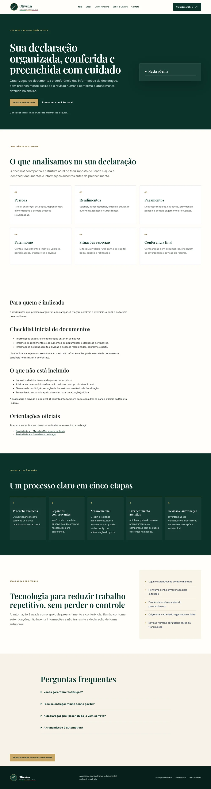

# Comparação visual — Etapa 2 → 2.1

Capturas reais de Chromium, fontes carregadas, viewport com 900 px de altura. Antes: `fec7143`. Depois: refinamento final `84d2bce`. Arquivos completos de desktop foram redimensionados para 1000 px para facilitar a leitura; mobile preserva 390 px.

## Indicadores de concisão no mobile

| Página (390 px) | Altura antes/depois | Texto DOM antes/depois | Links de análise no conteúdo | Links do checklist local |
| --- | --- | --- | --- | --- |
| AIRE | 4709 → 4076 px | 475 → 397 palavras | 3 → 2 | 0 → 0 |
| IR | 8781 → 7894 px | 649 → 596 palavras | 1 → 2 | 2 → 1 |

Contagem de texto considera o DOM do `main`, inclusive FAQ/índice recolhidos; não mede somente texto visível. Links de análise excluem o cabeçalho compartilhado. Em IR, duas ações repetidas de checklist viram uma, enquanto a análise fica disponível no início e no fim. O índice oferece atalhos sem adicionar CTAs de contratação. [Dados completos](evidence/comparison.json).

## Capturas

| Página | Antes mobile | Depois mobile | Antes desktop | Depois desktop |
| --- | --- | --- | --- | --- |
| AIRE | [Abrir](evidence/before-aire-390.webp) | [Abrir](evidence/after-aire-390.webp) | [Abrir](evidence/before-aire-1366.webp) | [Abrir](evidence/after-aire-1366.webp) |
| Imposto de Renda | [Abrir](evidence/before-ir-390.webp) | [Abrir](evidence/after-ir-390.webp) | [Abrir](evidence/before-ir-1366.webp) | [Abrir](evidence/after-ir-1366.webp) |
| Catálogo | [Abrir](evidence/before-catalogo-390.webp) | [Abrir](evidence/after-catalogo-390.webp) | [Abrir](evidence/before-catalogo-1366.webp) | [Abrir](evidence/after-catalogo-1366.webp) |
| Home | [Abrir](evidence/before-home-390.webp) | [Abrir](evidence/after-home-390.webp) | [Abrir](evidence/before-home-1366.webp) | [Abrir](evidence/after-home-1366.webp) |

## AIRE — depois, mobile

## IR — depois, desktop

## Catálogo — depois, mobile

