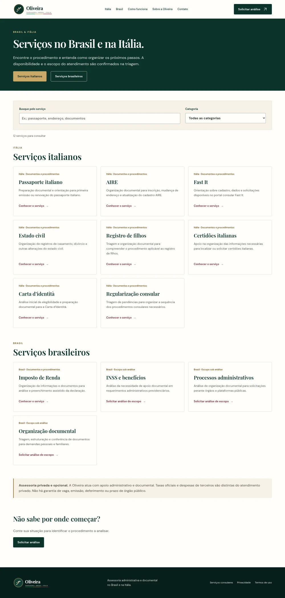
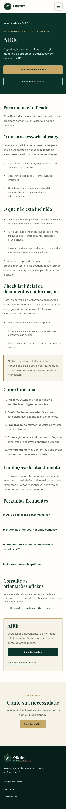

# Catálogo — capturas e comparação

Capturas reais em Chromium, viewport de 900 px de altura, fontes carregadas. Antes: `dfd9347` (aplicação da Etapa 1.1). Depois: implementação `222faf3`. Capturas completas de desktop redimensionadas a 1000 px para leitura; mobile preserva 390 px.

| Página | Antes mobile | Depois mobile | Antes desktop | Depois desktop |
| --- | --- | --- | --- | --- |
| Home | [Abrir](evidence/before-home-390.webp) | [Abrir](evidence/after-home-390.webp) | [Abrir](evidence/before-home-1366.webp) | [Abrir](evidence/after-home-1366.webp) |
| AIRE | [Abrir](evidence/before-aire-390.webp) | [Abrir](evidence/after-aire-390.webp) | [Abrir](evidence/before-aire-1366.webp) | [Abrir](evidence/after-aire-1366.webp) |
| IR | [Abrir](evidence/before-ir-390.webp) | [Abrir](evidence/after-ir-390.webp) | [Abrir](evidence/before-ir-1366.webp) | [Abrir](evidence/after-ir-1366.webp) |
| Catálogo novo | Não existia | [Abrir](evidence/after-catalogo-390.webp) | Não existia | [Abrir](evidence/after-catalogo-1366.webp) |

## Organização e comportamento

- Home: apresentação editorial e foto preservadas; acesso explícito ao catálogo completo por categoria.
- Catálogo: 8 serviços italianos e 4 brasileiros, busca e filtro sem backend; cartões compactos com título, descrição e destino claro.
- Detalhes: público, atividades, exclusões, checklist indicativo, etapas, limitações, FAQ e fontes, com CTA direto ao formulário. AIRE é a amostra visual do padrão aplicado às 8 páginas consulares.
- IR: documentação e exclusões acrescidas; valor legado retirado conforme o escopo desta etapa. Checklist local preservado.
- Três categorias brasileiras amplas sinalizam análise de escopo. Candidatos e legados sem aprovação não aparecem como novas ofertas.

## Catálogo — desktop

## Catálogo — mobile

## AIRE padronizado — mobile

